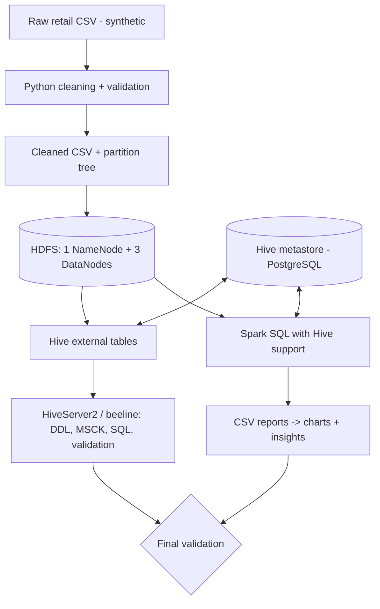

# Architecture

See `diagrams/architecture.mmd` (render at mermaid.live or in the GitHub preview).

## Role of each component
| Component | Role in this project |
|---|---|
| Python (pandas) | Generates synthetic data, cleans/validates it, writes the Hive-style partition directories. |
| HDFS | Stores the cleaned CSV (`/retail/staging`) and partition tree (`/retail/warehouse/sales`). Files are split into blocks and replicated (factor 3) over the DataNodes. NameNode keeps only metadata. |
| Hive metastore | Relational DB (PostgreSQL) that stores table schemas, HDFS locations and the list of registered partitions. It stores no data. |
| Hive (HiveServer2) | SQL layer. Defines external tables over HDFS files, registers partitions (`MSCK REPAIR TABLE`), runs the analysis and validation SQL. |
| Spark | Distributed in-memory engine. Reads the *same* Hive table through the metastore, runs the aggregations, writes the report CSVs. |
| Matplotlib | Turns the Spark report CSVs into PNG charts. |

## How HDFS, Hive and Spark connect
1. Hive stores **only metadata** in the metastore: table name -> columns -> HDFS path -> partitions.
2. Spark's `spark-client` container has `hive-site.xml` (`hive.metastore.uris=thrift://hive-metastore:9083`) and `core-site.xml` (`fs.defaultFS=hdfs://namenode:8020`) in `SPARK_CONF_DIR`/`HADOOP_CONF_DIR` (`docker/spark-client/conf/`).
3. `SparkSession.builder.enableHiveSupport()` makes Spark ask the metastore where `retail_dw.sales_partitioned` lives and which partitions exist, then read those HDFS files directly. Hive and Spark never copy data to each other - they share metadata and files.
4. Partition pruning: a filter on `region`, `sales_year` or `sales_month` lets the engine skip whole directories.

## Cluster honesty note
The compose file runs **one NameNode and three DataNode containers** on a single machine, plus Hive and a Spark client container. That demonstrates HDFS replication and block placement, but it is **not** three independent Hadoop worker nodes: there is no YARN, no Spark standalone/YARN executors on other nodes, and everything shares one host's CPU/RAM. Spark runs in `local[*]` mode inside the client container. Say this in the viva.

## Two execution modes
* `--mode local` - Spark with Hive support, embedded Derby metastore, local files. Same DDL and same queries as the cluster; no HDFS/HiveServer2. Used for development and CI-style checks.
* `--mode cluster` - the Docker stack above.
